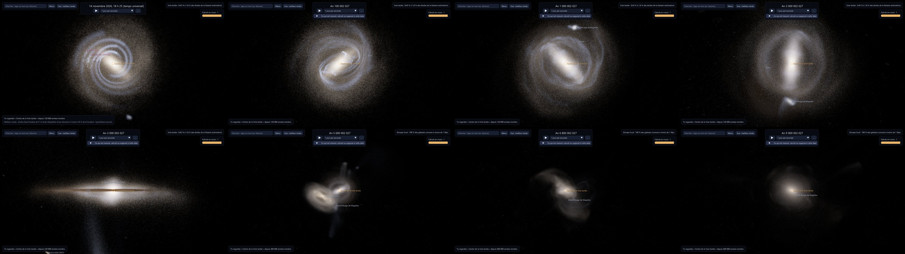

# Deuxième film du Groupe local : contrôle (18 novembre 2026)

Suite de `premier-film.md`. Objet : la barre doit rester (décision de Marc), le film doit partir sans sursaut, les
galaxies voisines doivent être portées par le calcul. Labels : [Certain] mesuré ; [Probable] déduit ; [À vérifier].

En haut : aujourd'hui, +100 Ma, +1 Ga, +3 Ga (de face). En bas : +3 Ga de profil, +5,6 Ga (premier passage d'Andromède),
+6,8 Ga (fusion), +9 Ga.

## Ce qui a changé

| Sujet | Premier film | Deuxième film |
|---|---|---|
| Galaxies de départ | disques stables, sans barre | centre calme (`modeles_v2.py --froid=0.9`), graine de barre, mûries 3 Ga seules (`stabilite_tir.py --guide`) : la barre naît et tient d'elle-même |
| Barre aujourd'hui | dessinée, absente de la masse | portée par la masse, calée à 3° près sur la barre mesurée (mode `barre`, deux passes) |
| Plan du disque | — | remis sur le plan mesuré à t = 0 (`caler_plan.py`, 1,6° d'écart après le trajet) |
| Étoiles d'aujourd'hui (Voie lactée) | tirées de formules | vieilles populations tirées des particules de masse (`etoiles_visibles_masse.py`) ; jeunes : places mesurées, hauteur comptée depuis le milieu local du disque, vitesse = courant moyen local |
| Galaxies voisines dans l'appli | blocs rigides | leurs étoiles suivent le film (marées visibles) |

## Mesures [Certain]

- Film : 1 001 images, 50 Go, énergie tenue à 0,04 %. Andromède : premier passage à +5,63 Ga à 14 kpc, les centres ne se
  quittent plus après +6,75 Ga. Triangle : s'échappe (746 kpc à +10 Ga). Nuages : absorbés.
- Départ (100 premiers Ma) : barre 0,34 → 0,40 ; disque vieux stable (0,55 kpc, rayon médian 5,2 kpc) ; jeunes
  0,11 → 0,14 kpc. Le sursaut du premier film a disparu pour la Voie lactée.
- Barre de la Voie lactée (force du motif à deux bras, 0,5 à 4 kpc) : 0,34 aujourd'hui, 0,39 à +1 Ga, 0,42 à +3 Ga,
  0,44 à +5 Ga. Elle tient jusqu'à la fusion.

## Écarts connus [Certain]

1. **La barre tourne trop lentement** : environ 20 km/s/kpc, pour 39 mesurés. Quatre réglages donnent 17 à 28 : c'est la
   vitesse naturelle de ce modèle de masse avec un halo sans rotation.
2. **La barre grossit sans arrêt** : entre 4 et 8 kpc, la force passe de 0,25 à 0,61 en 5 Ga ; à +3 Ga elle occupe presque
   tout le disque (capture).
3. **Le disque s'épaissit trop** : mesurée dans le plan propre du disque (qui penche de 14° en 5 Ga, sous l'effet des Nuages,
   dans les deux films), l'épaisseur des vieilles étoiles passe de 0,55 à 0,91 kpc en 3 Ga et 1,24 kpc en 5 Ga ; les
   jeunes de 0,10 à 0,64 kpc en 3 Ga. Dans le premier film (sans barre) : 0,21 → 0,28 kpc en 5 Ga. La cause est donc la
   barre, pas les Nuages.
4. **Ce n'est pas le grain de la matière noire** : essai avec des particules de halo 4 fois plus légères (10,85 M de
   particules, 3 Ga, Voie lactée seule) : même épaisseur, même agitation, même barre qu'à 3,5 M. L'hypothèse annoncée le
   17/11 était fausse.
5. Disque de départ déjà trop épais (0,55 kpc contre ~0,2 mesuré) : il sort du flambage de la barre pendant le mûrissement.
6. Andromède : ses étoiles sont posées d'après les photos, pas sur la masse ; épaisseur 0,16 → 0,45 kpc en 30 Ma.
7. Pas de gaz : pas d'étoiles nouvelles, les bras ne sont pas refaits.

## Suite proposée

Les barres des calculs sans gaz grossissent en cédant leur moment cinétique au halo. Deux leviers connus, à essayer sur la
Voie lactée seule (une heure de carte par essai) avant tout nouveau film : donner au halo la rotation mesurée dans les
simulations cosmologiques, et arrêter le mûrissement plus tôt (avant le flambage) pour partir d'un disque plus mince.
