# État des lieux, captures et ménage (13 novembre 2026, 10 h, heure du Québec)

Demande de Marc : « fais les captures et fais un rapport complet. On en est où ? Coupe le calcul actuel, on repart sur
du propre. Regarde quoi nettoyer, quoi faire propre, sauvegarder de l'espace. »

Ce document : ce que l'appli montre vraiment (17 captures de l'appli installée, fenêtre cachée), où en est chaque
chantier, et la liste de ménage. **Rien n'a été supprimé.** Documents liés : `analyse-architecture.md` (la cause et le
plan), `revue-detaillee.md` (les 17 défauts graves).

## 1. Ce qui a été fait à l'instant

- Calcul « Voie lactée seule » **arrêté** à 4,56 sur 4,7 milliards d'années. Ses fichiers sont intacts.
- Téléchargements **non touchés** : cartes WISE (infrarouge) et âges des étoiles Gaia continuent.
- 17 captures prises, environ 1 minute chacune. La carte graphique est libre.

## 2. Ce que l'appli montre vraiment

### Aujourd'hui

| Vue | Capture | Ce qu'on voit | Verdict |
|---|---|---|---|
| Système solaire | 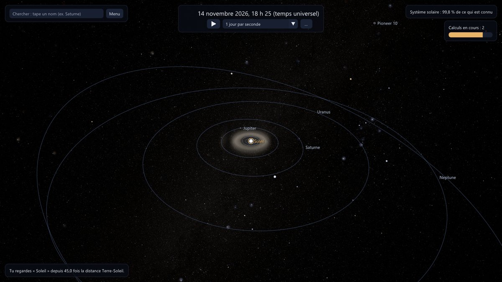 | Soleil, orbites, planètes, sonde | **Bon** |
| À 3 000 al du Soleil | 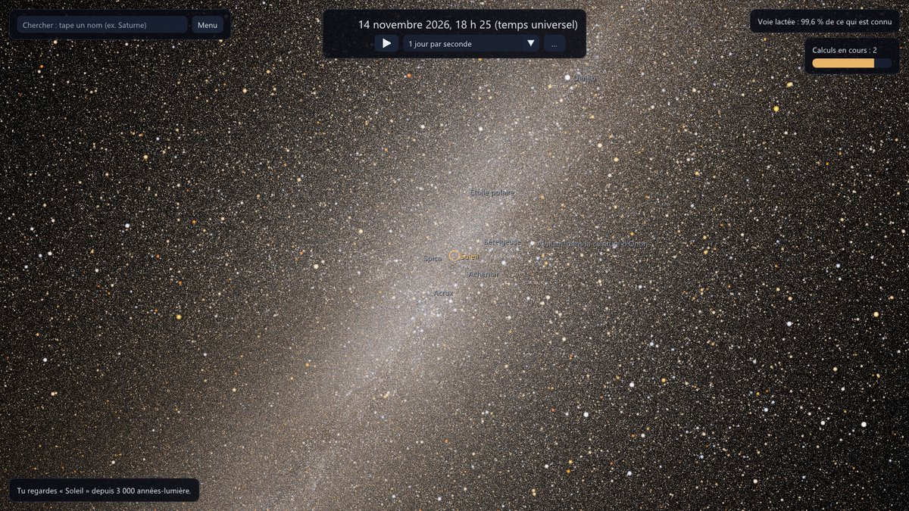 | étoiles Gaia, bande de la Voie lactée ; en haut : « Voie lactée : 99,6 % de ce qui est connu » | Image bonne ; **texte faux** (on a ~1 % des étoiles) |
| Toute la Galaxie (150 000 al) | 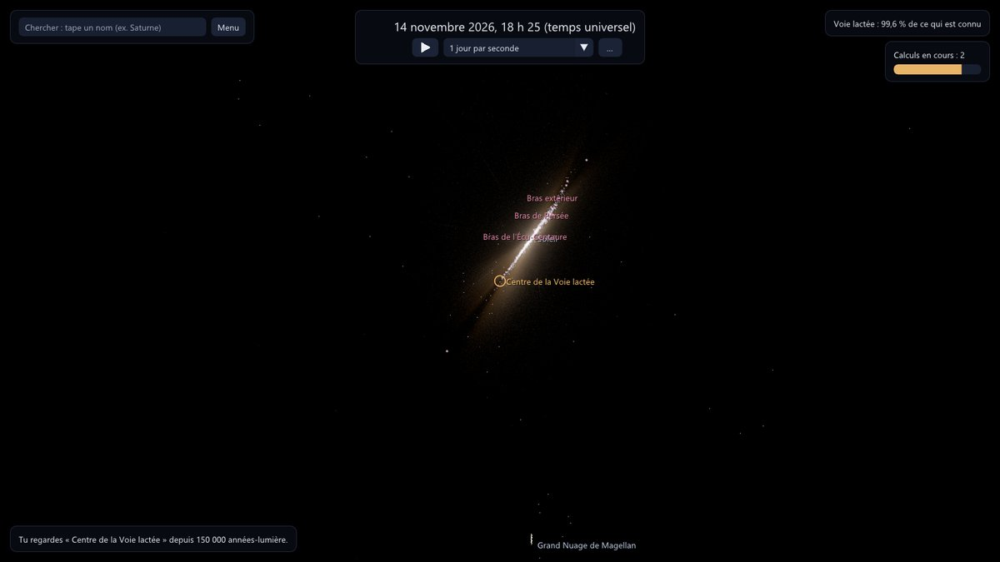 | **un trait blanc** : la bulle des étoiles mesurées vue de loin. Pas de disque, pas de bras, pas de bulbe | **Faux** |
| Groupe local (4 millions d'al) | 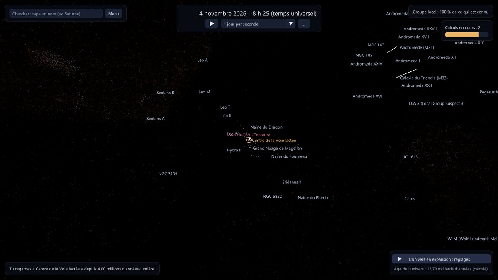 | des noms, et deux **traits blancs** à la place d'Andromède et du Triangle | **Faux** |
| Andromède de près | 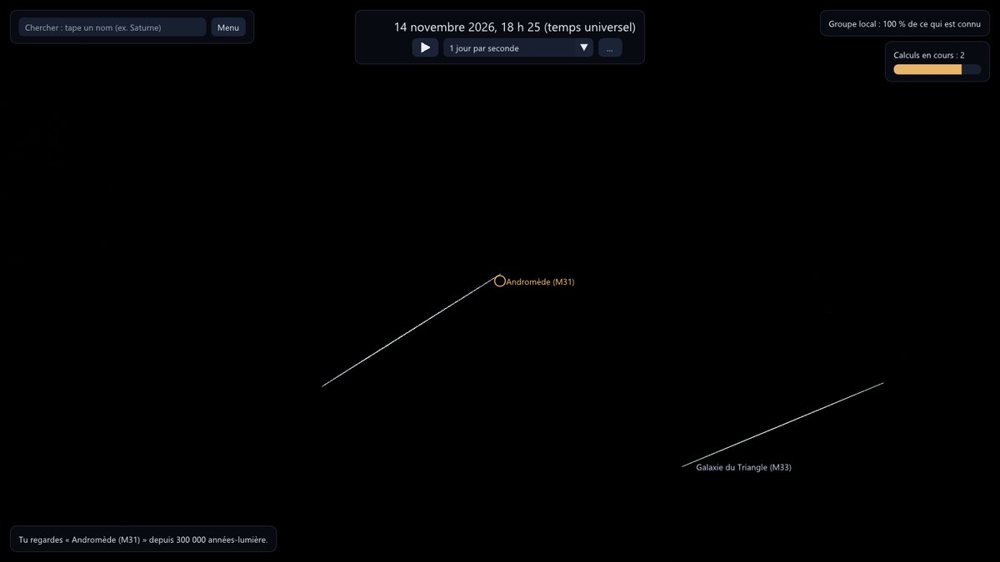 | écran noir et un **trait** : ce sont les 10 000 scénarios alignés sur l'incertitude de distance. Aucune galaxie | **Faux** : c'est le pire écran de l'appli |
| Univers lointain (1 milliard d'al) | 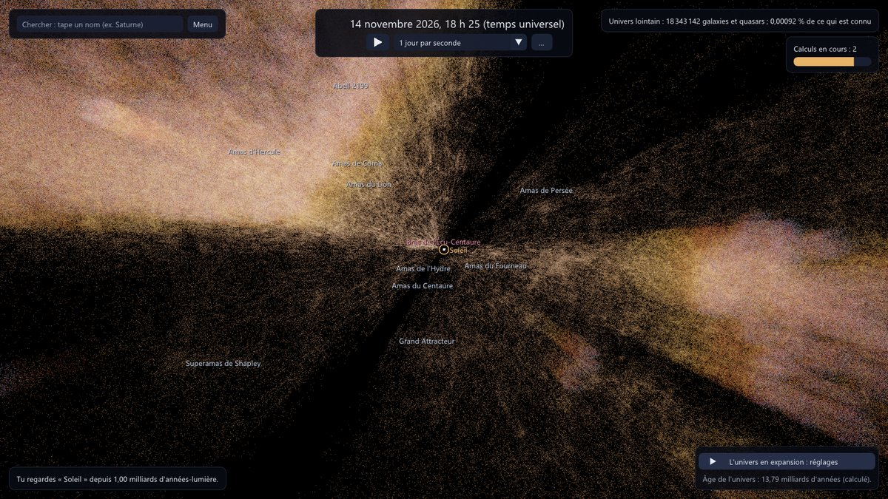 | les relevés de galaxies en éventails | Correct pour des points ; amas étirés vers nous |

### Quand le temps avance

| Vue | Capture | Ce qu'on voit | Verdict |
|---|---|---|---|
| An 3000, système solaire | 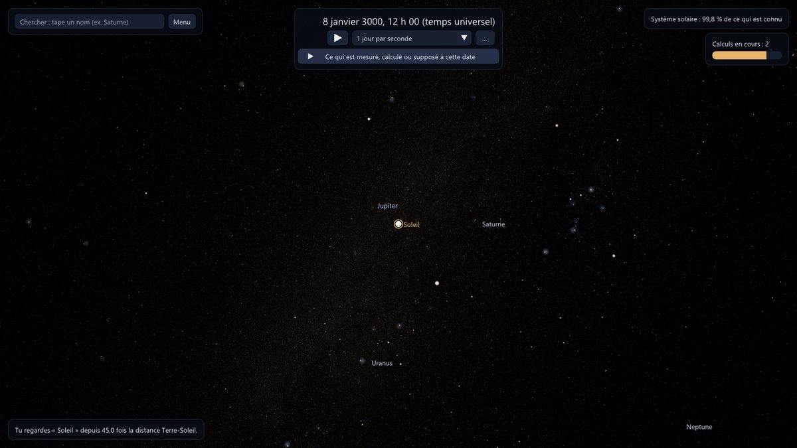 | noms des planètes, **plus d'orbites tracées, planètes non dessinées** | **Faux** (défaut I4 confirmé à l'écran) |
| +300 Ma, Galaxie | 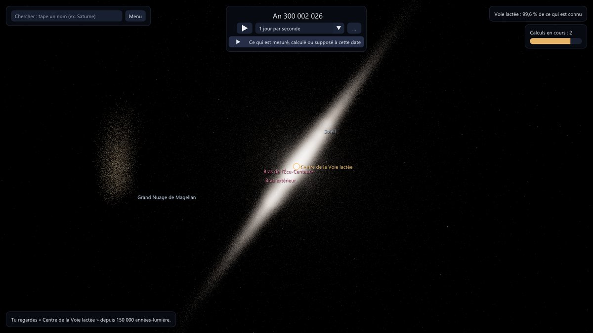 | une **aiguille blanche saturée** (le film « Voie lactée seule » de profil) et une tache beige (les scénarios du Nuage) | Autre objet qu'à t = 0 : la couture |
| +1 Ga, Galaxie | 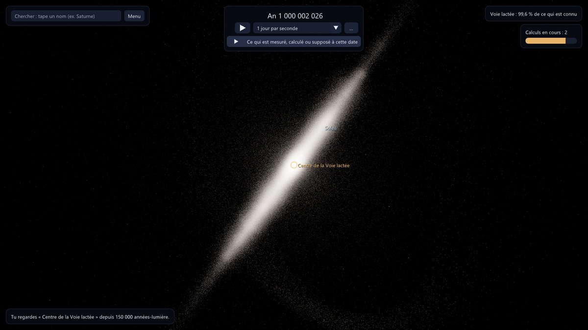 | la même aiguille, plus grosse | idem |
| +1 Ga, Groupe local | 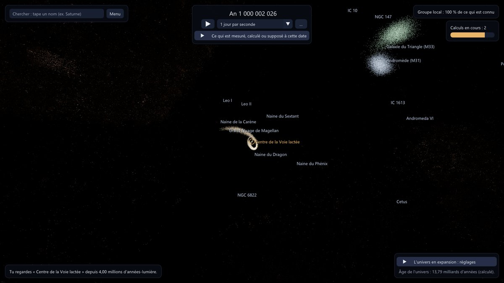 | Andromède = **boule bleutée**, Triangle = **boule verte**, Nuage = **arc beige** enroulé autour de la Voie lactée | **Faux** : exactement ce que Marc a vu ; ce sont des incertitudes, pas des galaxies |
| +3 Ga, Groupe local | 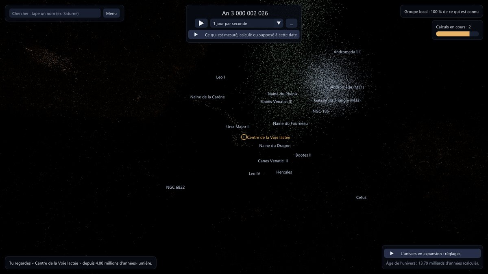 | les boules se dissolvent en brouillard sur tout l'écran | **Faux** |
| +4,5 Ga, rencontre | 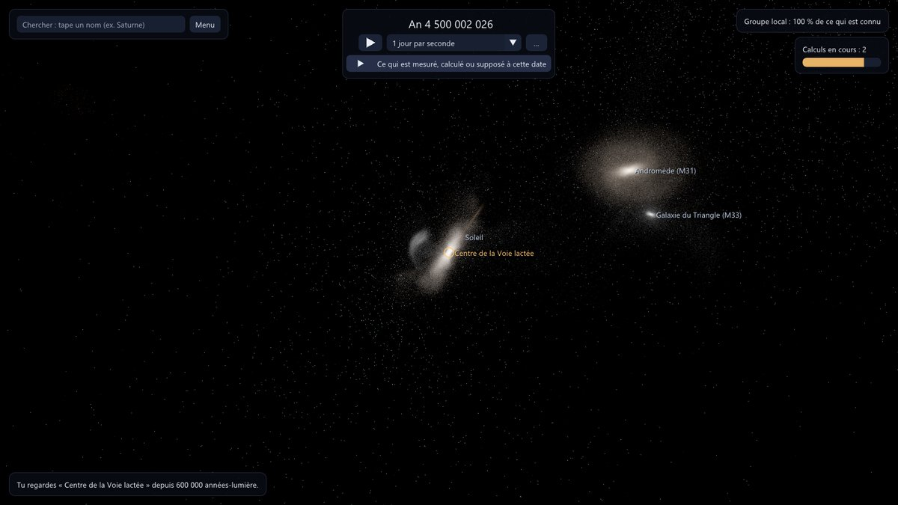 | deux vraies galaxies en particules, bras de marée, Triangle | **Le seul moment où l'on voit des galaxies** |
| +6 Ga, fusion | 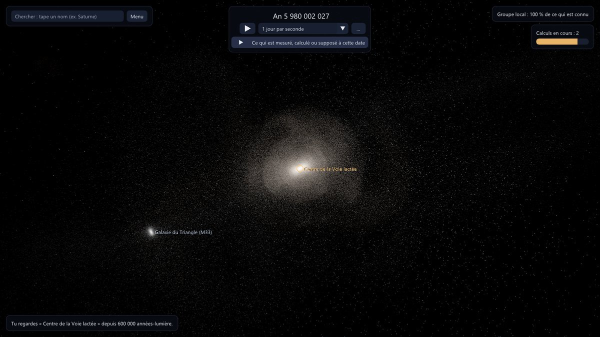 | une galaxie elliptique et le Triangle | Plausible |
| +5 Ga, univers lointain | 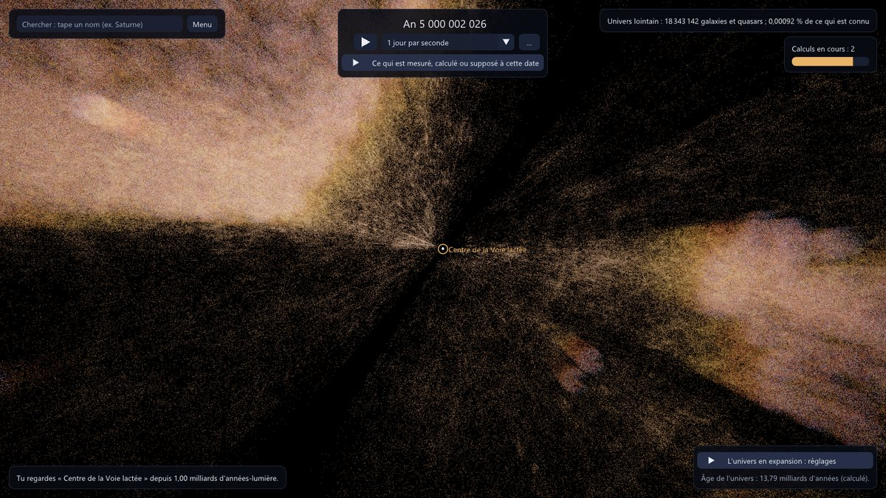 | même dessin, agrandi | amas gonflés avec l'expansion |

### Quand le temps recule

| Vue | Capture | Ce qu'on voit | Verdict |
|---|---|---|---|
| −500 Ma, Galaxie | 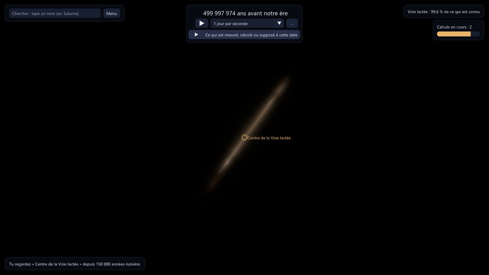 | un fin trait orangé | presque vide |
| −950 Ma, Galaxie | 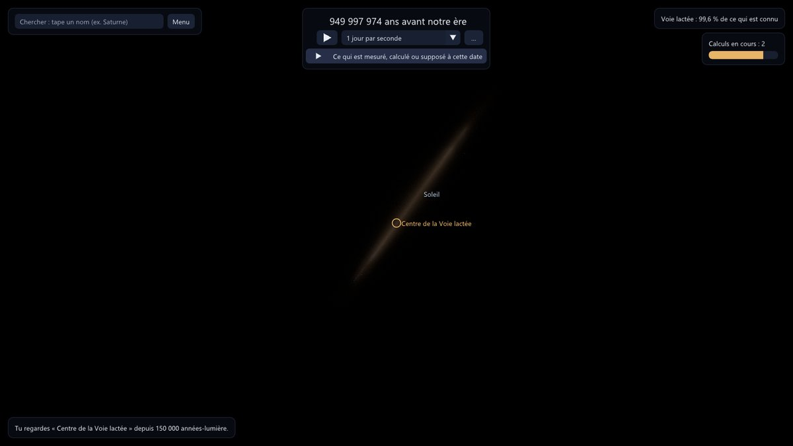 | le trait s'éteint ; le nom « Soleil » flotte seul | **Vide** |
| −500 Ma, Groupe local | 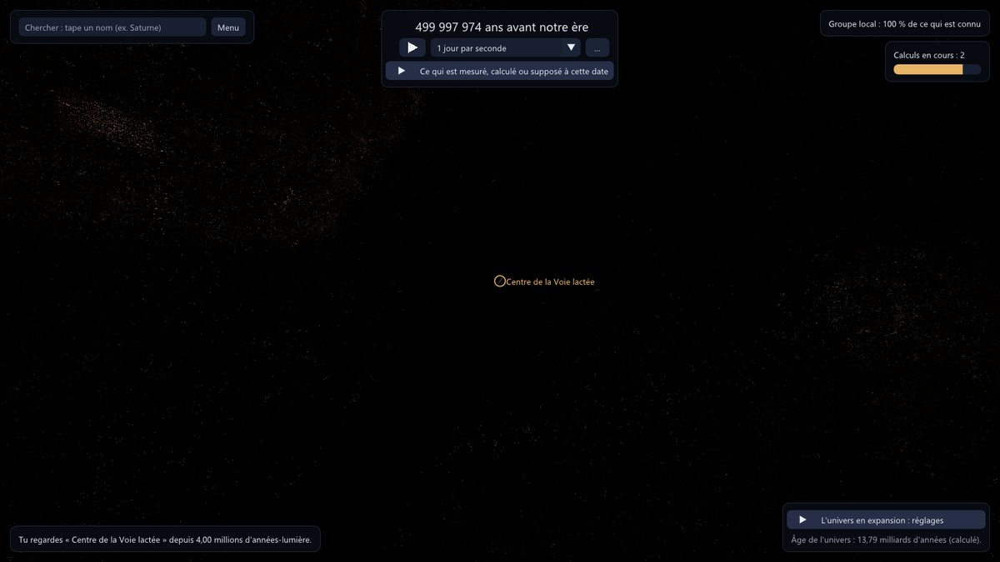 | **rien** : un seul nom sur fond noir | **Vide** (défaut I2 confirmé) |

### Ce que les captures prouvent

1. **La même Voie lactée est quatre objets différents** : un trait (aujourd'hui), une aiguille saturée (300 Ma à
   4 Ga), un disque en particules (4,5 Ga), un trait orangé qui s'éteint (passé). C'est la cause racine, vue à l'écran.
2. **Andromède n'existe pas avant 4 Ga.** Aujourd'hui c'est un trait, à 1 Ga une boule, à 3 Ga un brouillard.
3. **Le passé est vide.**
4. **Le système solaire d'aujourd'hui, le ciel à 3 000 al, la rencontre à 4,5 Ga et l'univers lointain sont bons à
   regarder.** Le reste est à refaire.
5. En haut à droite, « Calculs en cours : 2 » restait affiché alors que tout était fini ou arrêté.

## 3. Où en est chaque chantier

| Chantier | État | Où |
|---|---|---|
| Appli installée | version du 13/11, 1 h 40 ; dernière fusion des longueurs d'onde non installée | `C:\dev\Univers-PC` |
| Analyse de fond et plan | livrés, **en attente du oui de Marc** | PR 90 |
| Revue détaillée (17 graves) | livrée | PR 90 |
| Audit des forces | livré, repris dans la PR 90 ; la PR 89 fait doublon | PR 89 à fermer |
| Voie lactée entière, énergie noire, départ dans le passé | code écrit, **non fusionné, non installé** ; le départ dans le passé n'est pas prêt (revue § 5) | branche `galaxie-entiere` |
| Vie des étoiles, lumière déviée | code écrit et essais verts, **non fusionné, non installé** ; téléchargement des âges en cours | branche `etoiles-vie` |
| Longueurs d'onde | fusionné ; WISE 12 µm en cours (ralenti par le serveur), 22 µm ensuite | `appli-pc` |
| Précalcul (clones d'étoiles, horizon Gaia, chaos) | 13 enregistrements non fusionnés | branche `natif-precalcul` |
| Calcul « fusion-toutes » (3 M) | fini ; c'est ce que montre l'appli après 4,3 Ga ; **départ faux** (revue G1 à G5) | `C:\tmp\natif\donnees\fusion-toutes` |
| Calcul « Voie lactée seule » (10,5 M) | **arrêté** ; départ faux lui aussi | `C:\tmp\natif\donnees\voie-lactee-seule` |
| Tests automatiques de l'appli PC | **aucun** | — |

## 4. Ménage proposé (rien n'est fait sans le oui de Marc)

Place : disque C: **293 Go libres** sur 1 862. Univers occupe environ **240 Go sur le PC** (la limite convenue est
100 Go) et **505 Go sur le Drive** (sur 20 To). Les tailles ci-dessous sont celles que Windows affiche ; certains
dossiers partagent des fichiers, le gain réel sera mesuré à la suppression.

### A. À supprimer sur le PC : essais et doublons, tout se refabrique (environ 120 Go affichés)

| Dossier | Taille | Pourquoi c'est sûr |
|---|---|---|
| `C:\tmp\rayons` | 68 Go | essais du 12/11 sur l'éclat de Gaia, résultat déjà dans l'appli |
| `C:\tmp\natif\essai_tuiles` | 17,7 Go | essai des tuiles Gaia, les vraies sont sur le Drive |
| `C:\tmp\natif\donnees\voie-lactee-seule` et `C:\tmp\natif\voie-lactee-seule` | 7,7 Go | calcul arrêté, départ faux, copie complète sur le Drive |
| `C:\tmp\natif\gaia_b.parquet` | 6,4 Go | déjà converti ; l'archive Gaia complète est sur le Drive |
| `C:\tmp\natif\gaia\brut` | 5,5 Go | fichiers Gaia d'origine, remplacés par l'archive du Drive |
| `C:\tmp\natif-ui\sansagg` | 4,7 Go | essai d'interface du 12/11 |
| `C:\tmp\natif\gaia\gaia_avant_rayons.bin` | 2,2 Go | ancienne version |
| `C:\tmp\nettoyage` et `C:\tmp\deps` | 7,9 Go | restes d'octobre **d'autres projets** (JobAI, CarAI, FinanceAI…) : à confirmer par Marc |
| vieilles captures et dossiers de fabrication dans `C:\tmp` | ~2 Go | refaits à la demande |

### B. À garder pour l'instant

- `C:\dev\Univers-PC` (24 Go) : l'appli et ses données.
- `fusion-toutes` (2,8 Go) : ce que l'appli montre après 4,3 Ga, jusqu'au nouveau calcul.
- `C:\tmp\mist` (10 Go), `gaia\ap` (6,5 Go), identifiants Gaia : servent à la vie des étoiles, en cours.
- `C:\dev\univers-ondes-donnees` (14,7 Go) : téléchargement WISE en cours.
- Erreurs Gaia, horizon, fond diffus, poussière (12,6 Go) : entrées de calculs à refaire proprement.

### C. Sur le Drive (505 Go) : rien d'urgent

- `physique\voie-lactee-seule` (13 Go) et `physique\fusion-toutes` (8 Go) : calculs à départ faux, supprimables quand
  le nouveau calcul existera.
- Les archives brutes des cartes du ciel (environ 210 Go) doublent les tuiles déjà fabriquées. Avec 20 To, je
  recommande de les garder : elles évitent de retélécharger pendant des heures.

### D. Dépôt de code

- **77 branches** sur GitHub, dont 38 déjà fusionnées et une trentaine d'anciennes branches de la page web : à
  supprimer, sauf les 5 vivantes (`appli-pc`, `main`, `galaxie-entiere`, `etoiles-vie`, `natif-precalcul`) et celle de
  cette analyse.
- **14 copies du dépôt** dans `C:\dev` (une par ancien fil) : toutes propres et poussées, sauf `univers-galaxie`
  (5 fichiers non enregistrés, à regarder avant). Une seule copie suffit désormais.
- PR 89 à fermer (doublon de la PR 90).
- Trois petits serveurs de test oubliés tournent encore (ports 8765 à 8767) : à arrêter.

### E. Faire propre dans le code (fait partie du plan, étape 0)

- Une seule table de constantes (aujourd'hui une même conversion est recopiée dans 8 fichiers et 6 programmes de carte).
- Découper la fonction de 670 lignes qui fait tout ; retirer le code mort encore appelé.
- Notices périmées : `HANDOVER.md` décrit l'ancienne page web ; 19 documents de plan sans sommaire.
- Mettre les essais de l'appli PC dans le contrôle automatique.

## 5. Repartir sur du propre : l'ordre

Je prends « on repart sur du propre » comme le oui au plan B. Ordre de travail :

1. **Ménage** (liste A et D), après le oui de Marc sur les suppressions.
2. **Vérité de l'écran** : textes et étiquettes faux, planètes hors 1550-2650, scénarios retirés de la vue par défaut.
3. **Essais automatiques**, dont l'essai de continuité qui échoue aujourd'hui partout où les captures cassent.
4. **Modèles de départ corrigés**, petits tirs de contrôle (environ 2 h de carte chacun).
5. **Le grand calcul**, une seule fois, quand les tirs passent. Pas avant.

## 6. Limites

- Captures prises en fenêtre cachée, image fixe : le mouvement et les bascules en lecture ne sont pas filmés.
- Les tailles de dossiers comptent parfois le même fichier plusieurs fois.
- La date de la capture 13 s'est arrêtée à 5,98 Ga pour 6 demandés (borne du calcul d'orbites) : non creusé.
