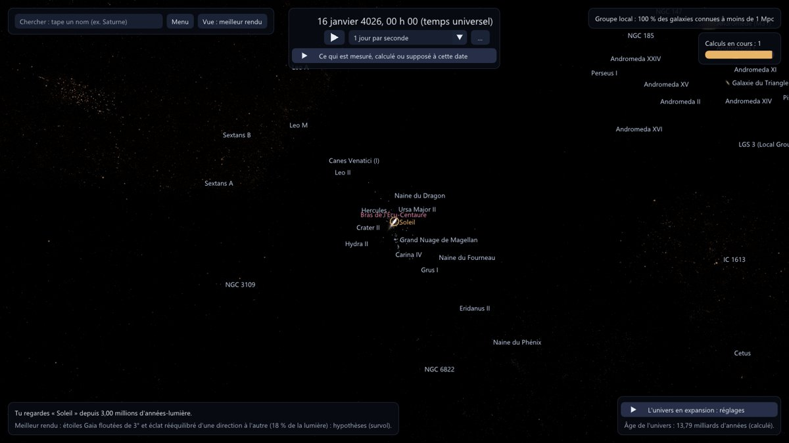
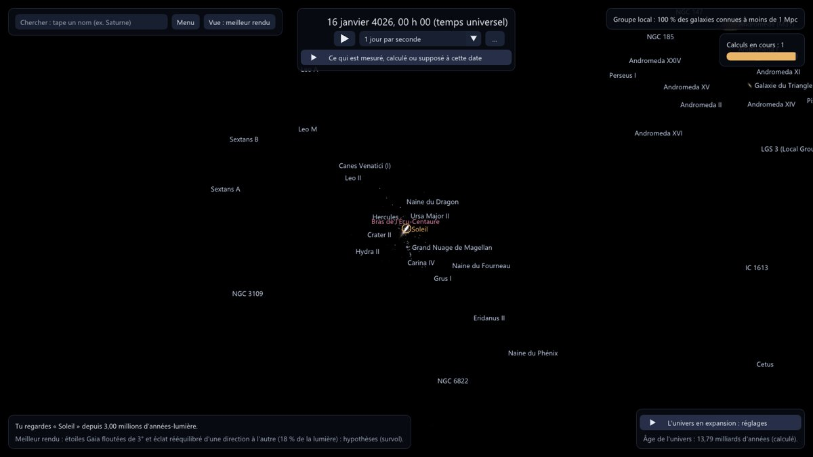
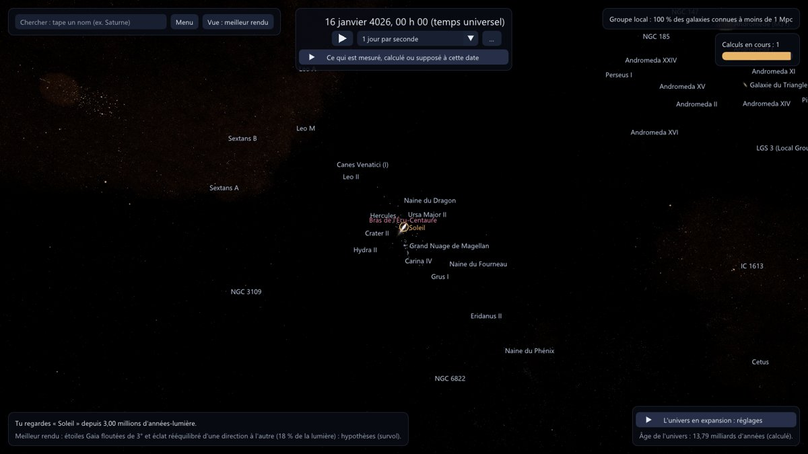

# Étoiles hors des galaxies : vrai ou faux ? (18 novembre 2026)

Question de Marc : « plein d'étoiles qui n'appartiennent à aucune galaxie se baladent ; vérifie si c'est possible ou si la
plupart font partie de galaxies, et corrige ». Labels : [Certain] mesuré ici ; [Probable] source lue ; [À vérifier].

## Réponse courte

1. **Dans l'univers réel, presque toutes les étoiles sont dans une galaxie** ou dans son halo (lié à elle par la gravité).
   Les étoiles vraiment entre les galaxies existent, mais leur part dépend du milieu :
   - dans les gros amas de galaxies, la « lumière intra-amas » (étoiles arrachées par les marées) fait environ 10 à 40 %
     de la lumière (simulations de Rudick et al. 2011 : 9 à 36 % selon la définition) [Probable] ; la mesure dépend
     beaucoup de la définition (revue de Montes 2019, arXiv:1912.01616) [Probable] ;
   - dans les groupes, Ragusa et al. 2023 (A&A 670, L20, relevé VEGAS, 22 groupes et amas) trouvent une part très
     dispersée, sans lien net avec la masse [Probable, chiffres lus dans des articles qui les citent : environ 5 à 45 %] ;
   - dans le Groupe local, pas de lumière intragroupe détectée à ce jour [À vérifier] ; la Voie lactée a un halo
     d'étoiles d'environ 10⁹ masses solaires (Deason, Belokurov et Sanders 2019, MNRAS 490, 3426 : 1,5 ± 0,4 × 10⁹
     dans la version arXiv) [Probable], soit 2 % environ de ses étoiles, liées à elle ;
   - les étoiles éjectées à grande vitesse (« hypervéloces ») existent mais se comptent par centaines (Brown 2015,
     ARA&A 53, 15) [Probable].
2. **Dans l'appli, les étoiles ne se baladent pas hors des galaxies aujourd'hui** [Certain] : voir les mesures.
3. **Les points que Marc a vus sont des galaxies lointaines**, pas des étoiles [Certain] : 18 343 142 galaxies et quasars
   des relevés (`galaxies.bin`), dessinés comme des points, avec un éclat d'affichage fixe qui ne suivait pas la loi des
   étoiles. Vus du Groupe local, ils ressemblaient à un champ d'étoiles entre les galaxies.

## Mesures dans le film du Groupe local [Certain]

Script : `pipeline/natif/mesure_hors_galaxies.py` (film `C:/tmp/natif/groupe-local-2/film`, lumière de chaque étoile
visible). Part de la lumière à plus de 50 kpc de TOUS les centres de galaxies :

| Date | Voie lactée | Andromède | Triangle | Grand Nuage | Petit Nuage | Toutes |
|---|---|---|---|---|---|---|
| aujourd'hui | 0,00 % | 0,00 % | 0,00 % | 0,00 % | 0,00 % | 0,00 % |
| +3 Ga | 0,00 % | 0,00 % | 0,00 % | 0,07 % | 4,2 % | 0,02 % |
| +6,8 Ga (fusion) | 0,06 % | 2,4 % | 0 % | 23 % | 63 % | 1,9 % |
| +9 Ga | 0,6 % | 4,0 % | 0 % | 33 % | 69 % | 3,3 % |

Lecture : les Nuages de Magellan sont déchirés par la Voie lactée puis par la fusion (c'est attendu : des courants de
marée comme celui du Sagittaire aujourd'hui) ; après la fusion, environ 3 % de la lumière forme un grand halo autour de
la galaxie fusionnée, ordre de grandeur des halos des grandes elliptiques [Probable]. Aucun écart avec la physique ici.

Écart inverse, non corrigé ici : aujourd'hui seulement 0,01 % de la lumière de la Voie lactée est à plus de 30 kpc de
son centre ; le halo d'étoiles réel (≈ 2 % des étoiles, dont une partie au-delà de 30 kpc) n'est pas dans les étoiles
visibles du film (disque et bulbe seulement) [Certain pour le film ; Probable pour la comparaison].

## Ce qui dessinait les points « perdus » [Certain]

Captures en fenêtre cachée, vue à 3 millions d'années-lumière du Soleil, aujourd'hui :

| Avec les galaxies (avant) | Sans les fichiers de galaxies |
|---|---|
|  |  |

Sans `galaxies.bin` et `galaxies_formes.bin`, il ne reste entre les galaxies voisines que quelques points près de la Voie
lactée (galaxies naines). Même chose dans 9 milliards d'années (`sans_galaxies_plus9Ga.jpg`). Aucune galaxie des
relevés n'est placée dans le Groupe local : le plus petit décalage vers le rouge est 0,0012 (environ 5 Mpc).

## Correction

- `shaders/galaxies.vert` : l'éclat de chaque galaxie lointaine suit la même loi que les étoiles et les galaxies de
  forme mesurée : exposition commune × 10^(−0,4 m) × 1/d². La magnitude m vient de la luminosité déjà tirée de la
  fonction de Schechter (Blanton et al. 2003) et de la distance de luminosité [supposé : l'éclat n'est pas dans les
  catalogues]. Quasars : magnitude 20 pour tous [supposé, À vérifier]. Plus de « gain d'affichage » ni de fondu.
- `interface_bas.h` : la ligne de provenance dit que ces points sont des galaxies, pas des étoiles.

Après la correction (même vue) :

Effet : les galaxies lointaines deviennent une lueur faible et quelques points plus brillants, comme sur une photo à
longue pose. Ce n'est pas moins de points : avec la vraie loi, le fond de galaxies est réel et visible en pose longue.
Les taches plus denses suivent les zones couvertes par les relevés (SDSS, DESI), pas tout le ciel.

## Pas vérifié
- La fenêtre réellement affichée (captures en fenêtre cachée seulement).
- Pas de test automatique de l'éclat dans le shader (contrôle par captures).
