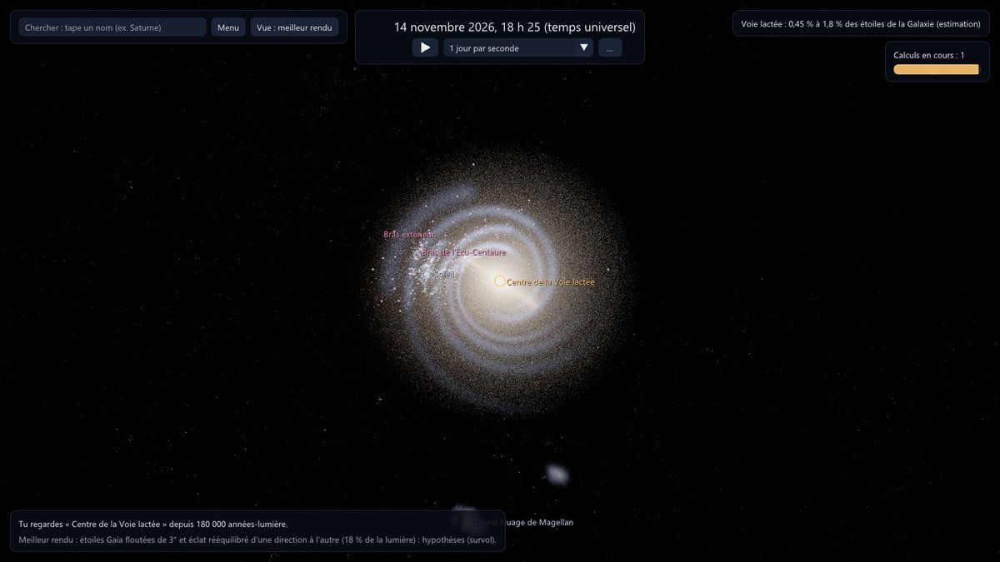
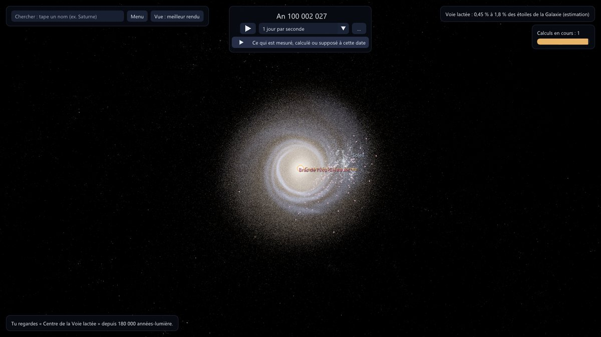
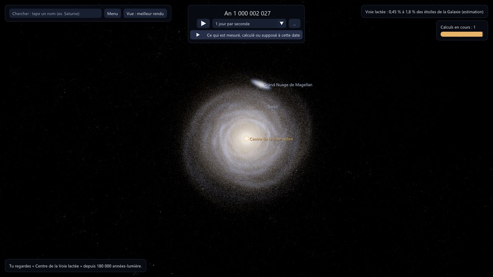
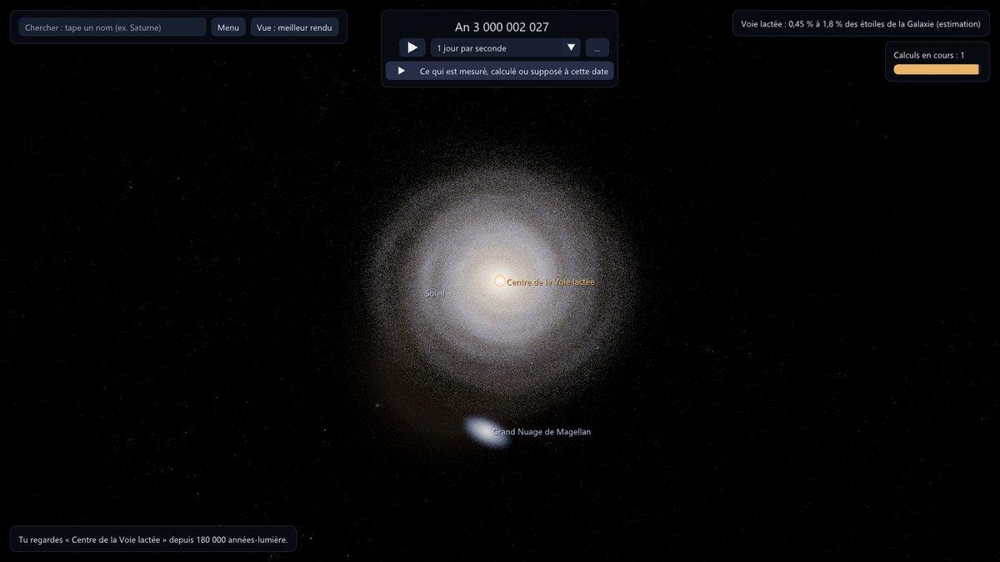
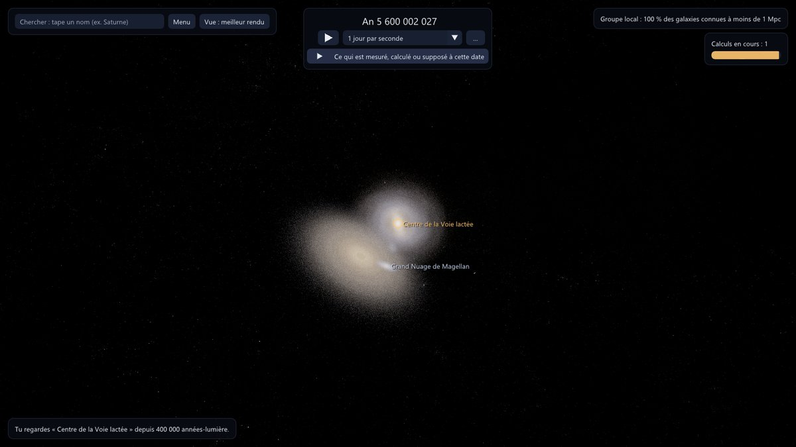
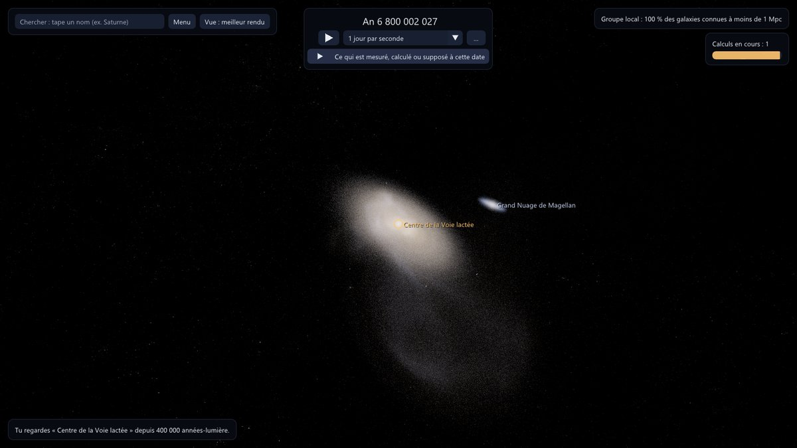
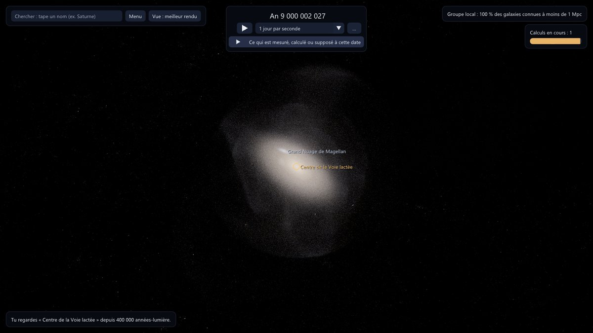

# Premier film du Groupe local : contrôle (16 novembre 2026)

Le premier calcul unique du plan B+ est terminé : cinq galaxies en particules qui s'attirent toutes, énergie noire
comprise, d'il y a 1 milliard d'années à +10 milliards d'années, avec les 8,5 millions d'étoiles visibles d'aujourd'hui
emportées par le calcul. Ce document dit ce qui est bon, ce qui ne l'est pas, et ce qui suit.

Labels : [Certain] mesuré sur le film ou vu en capture ; [Probable] déduit ; [À vérifier] non mesuré.

## 1. Le calcul

| | Valeur | |
|---|---|---|
| Particules de masse | 9,8 millions (Voie lactée 3,5 ; Andromède 4 ; Triangle 1 ; Grand Nuage 1 ; Petit Nuage 0,3) | |
| Étoiles visibles emportées | 8,5 millions (4 ; 3 ; 0,5 ; 0,5 ; 0,5) | |
| Film | 1 001 images, une tous les 10 millions d'années, de 0 à +10 Ga ; 50 Go | toutes les images entières [Certain] |
| Champ de gravité | 501 dates × 5 galaxies | écrit sans erreur [Certain] ; pas encore relu par l'appli |
| Durée de carte graphique | environ 22 h pour le futur, 1 h pour le passé | [Certain, journal] |
| Interruptions | 4 (fin de session, pause demandée, deux retraits pour laisser la carte) | reprises sans trou ni doublon dans les dates [Certain] |
| Énergie | écart de 0,055 % au plus sur 10 Ga | [Certain] |

## 2. Ce que le calcul raconte [Certain, lu dans le film]

| Galaxie | Aujourd'hui | Ensuite |
|---|---|---|
| Andromède | 766 kpc (mesuré : 761), à 2,3 kpc et 10 km/s de sa place mesurée | premier passage dans **5,6 Ga**, à 14 kpc ; les deux centres ne se quittent plus après **6,7 Ga** ; fusion faite vers 6,85 Ga |
| Triangle | à 1,8 kpc de sa place | passe à 151 kpc d'Andromède dans 0,8 Ga, **ne fusionne pas** : il est à 734 kpc à +10 Ga |
| Grand Nuage | à 3,9 kpc et 52 km/s de sa place | orbite qui se resserre (27, 22, 19, 18, 17 kpc), déchiré puis absorbé vers 7 Ga |
| Petit Nuage | à 8,2 kpc de sa place | passe à 10 kpc de la Voie lactée dans 2 Ga, déchiré, absorbé vers 6,5 Ga |

La date de la fusion tombe dans la fourchette de l'ensemble de scénarios bâti sur les mêmes masses (médiane 6,65 Ga,
96 % de fusions) [Probable : chiffres du fil « table unique », non recalculés ici]. C'est **un** scénario, pas une prévision.

## 3. Ce que l'appli montre

| Date | Capture | Verdict |
|---|---|---|
| Aujourd'hui |  | vraie spirale, bras et barre d'après les mesures : **bon** |
| +100 Ma |  | les bras sont encore là, plus enroulés ; **la barre a déjà disparu** ; un paquet de points blancs flotte à côté du centre (ancien calque des traceurs de bras, tourné d'un bloc) : **faux** |
| +1 Ga |  | spirale enroulée serré, plus pâle |
| +3 Ga |  | disque presque lisse, anneaux pâles |
| +5,6 Ga |  | premier passage d'Andromède : deux galaxies qui se traversent |
| +6,8 Ga |  | fusion, grande queue de marée ; le Grand Nuage est dessiné intact alors que le calcul l'a détruit : **faux** |
| +9 Ga |  | galaxie elliptique avec ses coquilles : plausible |

Rien ne saute quand le temps démarre : l'image 0 du film est celle d'aujourd'hui (0,1 pc d'écart). C'était le but.

## 4. Les défauts, mesurés

Force du motif à deux bras des étoiles visibles (0 = rond ; 0,15 = barre ou bras nets), épaisseur du disque, taille :

| Voie lactée | 0,5 à 4 kpc (barre) | 4 à 8 kpc | 8 à 14 kpc | épaisseur | rayon médian |
|---|---|---|---|---|---|
| aujourd'hui | 0,153 | 0,114 | 0,131 | 0,10 kpc | 4,3 kpc |
| +50 Ma | 0,049 | 0,086 | 0,077 | **0,17** | **5,1** |
| +100 Ma | 0,022 | 0,031 | 0,075 | 0,16 | 4,5 |
| +300 Ma | 0,008 | 0,006 | 0,029 | 0,15 | 4,8 |
| +1 Ga | 0,016 | 0,039 | 0,038 | 0,19 | 4,7 |
| +2 Ga | 0,024 | 0,036 | 0,059 | 0,32 | 4,7 |
| +4 Ga | 0,054 | 0,019 | 0,069 | 0,70 | 4,7 |
| +6 Ga | 0,162 | 0,130 | 0,091 | 1,04 | 4,7 |
| +8 Ga (après la fusion) | 0,298 | 0,458 | 0,483 | 4,3 | 5,9 |

| Andromède | barre | épaisseur | rayon médian |
|---|---|---|---|
| aujourd'hui | 0,099 | 0,16 kpc | 9,1 kpc |
| +100 Ma | 0,011 | **0,31** | **10,6** |
| +1 Ga | 0,011 | 0,29 | 9,9 |

1. **La barre s'efface en 100 millions d'années** [Certain]. J'avais annoncé « quelques centaines de millions d'années » :
   c'est plus rapide. Cause : aucune barre dans la masse. C'est l'objet de l'étape suivante, décidée par Marc.
2. **Les bras s'enroulent puis pâlissent en 1 à 3 milliards d'années** [Certain]. Le chiffre à deux bras tombe vite parce
   que les bras s'enroulent ; à l'œil la spirale reste visible jusque vers 1 Ga. Sans gaz, rien ne les refait.
3. **Un sursaut dans les 50 premiers millions d'années** [Certain, nouveau] : le disque de la Voie lactée s'épaissit de
   70 % et gonfle de 20 %, celui d'Andromède double d'épaisseur. Les étoiles visibles sont posées plus fines que la masse
   qui les porte et avec des vitesses qui ne sont pas tout à fait à l'équilibre dans cette masse. C'est une petite cassure
   au démarrage, que la règle « un objet, une histoire » interdit.
4. **Le disque de la Voie lactée s'épaissit trop avec le temps** : 0,7 kpc à +4 Ga [Certain]. Une part vient des Nuages
   qui le traversent, une part des particules de matière noire trop lourdes (8 fois celles des étoiles) [Probable].
5. **Andromède, le Triangle et les Nuages sont encore dessinés en blocs** [Certain] : seul leur centre suit le film. Ils ne
   se déforment pas, et les Nuages restent intacts à l'écran alors que le calcul les a détruits.
6. **L'ancien calque des traceurs de bras** tourne d'un bloc par-dessus les étoiles du film [Certain].

## 5. Suite

Ordre fixé par Marc le 13 novembre (« 3 puis 1 puis 2 ») : ce premier film est le « 3 ». Vient maintenant le « 1 ».

1. **La vraie barre** : masse centrale de la Voie lactée et d'Andromède mise en barre avec une barre guide qui tourne à la
   vitesse mesurée, puis retirée (`stabilite_tir.py --guide`). Essais de 20 à 40 minutes de carte.
2. **Poser les étoiles visibles à l'équilibre dans la masse** (défaut 3) : épaisseur et vitesses tirées des particules de
   masse voisines, pas d'une formule à part.
3. **Brancher les étoiles des quatre autres galaxies sur le film**, une à une (défaut 5), et retirer l'ancien calque des
   bras quand le film mène (défaut 6).
4. Matière noire plus fine pour la Voie lactée (défaut 4), si la carte le permet.
5. Recalcul. Ce premier film reste sur le PC pour brancher l'appli ; il n'a pas vocation à être archivé.

## 6. Limites de ce contrôle

- Captures en image fixe : le mouvement en lecture n'est pas filmé.
- La vitesse de rotation de la barre et les orbites étoile par étoile n'ont pas été comparées à une référence.
- Le passé (avant aujourd'hui) n'est pas dans le film : l'appli y garde ses orbites de référence.
